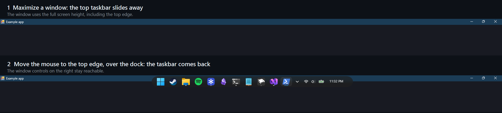
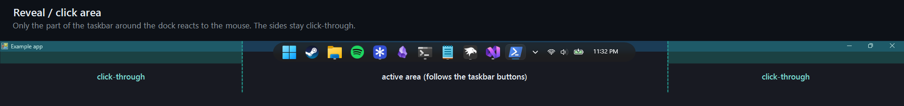

<h1 align="center">Taskbar auto-hide when maximized</h1>

<b>Üstteki görev çubuğu desteği</b> · Windows 11 için bir <a href="https://windhawk.net/">Windhawk</a> modu

  
  
  
  

🇬🇧 English: <a href="README.md">README.md</a>

Bir pencere büyütüldüğünde görev çubuğunu gizler, ekran alanına ihtiyaç kalmayınca
geri getirir. Görev çubuğu ekranın **üstündeyken** de çalışır ve **dock tarzı**
bir görev çubuğunun yanındaki boş alandan tıklamanı sağlar (örneğin büyütülmüş
pencerenin kapat düğmesi).

m417z'nin *Taskbar auto-hide when maximized* modunu temel alır.

  

## Neden ayrı bir mod?

Windows 11, alt kenar dışındaki her görev çubuğu konumunda otomatik gizlemeyi
kapatır ("Bu ayar yalnızca görev çubuğu altta olduğunda kullanılabilir"). Orijinal
mod bu otomatik gizlemeye dayandığı için, çubuk üstteyken hiçbir şey yapmıyordu.
Bu sürüm o kontrolü kapatır, böylece normal otomatik gizleme mantığı üstteki çubukta
da çalışır.

Üstteki çubuğun ikinci bir sorununu da giderir: çubuk aşağı kayıp açıldığında,
dock tarzı çubuğun iki yanındaki saydam alan büyütülmüş pencerenin küçült / büyüt /
kapat düğmelerinin üstünü kapatır. Ayrıca ekranın üst kenarında dock'un yanına
dokunmak bile çubuğu açar.

## Kurulum

1. [Windhawk](https://windhawk.net/)'ı kur.
2. Windhawk'ta **Create a new Mod** düğmesine bas.
3. Editördeki tüm kodu sil ve [`taskbar-auto-hide-top.wh.cpp`](taskbar-auto-hide-top.wh.cpp)
   dosyasının içeriğini yapıştır.
4. **Compile Mod**'a bas (ilk derleme Explorer sembollerini indirir, bir dakika
   sürebilir), sonra editörden çık ve modu etkinleştir.

## Hızlı başlangıç

1. **Orijinal** *Taskbar auto-hide when maximized* modunu **kapat**. İki mod aynı
   fonksiyonlara kanca takar, aynı anda çalışmamalı.
2. Bu modu kur ve etkinleştir.
3. Bir pencereyi büyüt. Görev çubuğu kayarak gizlenmeli. Fareyi ekranın üst
   kenarında dock'un üstüne götürünce geri gelir.

Dock tarzı bir çubuğun yoksa (çubuk ekranın tam genişliğindeyse)
**Reveal / click area** ayarını *Full width* yap.

## Ayarlar

### Mode (Mod)

* **Auto-hide when a window is maximized or intersects the taskbar**: büyütülmüş
  veya çubukla kesişen pencere varken gizle.
* **Auto-hide only when a window is maximized** (varsayılan): yalnızca büyütülmüş
  pencere varken gizle.
* **Never auto-hide**: hiç gizleme.

### Reveal / click area (Açılma / tıklama alanı)

Görev çubuğu penceresinin fareye tepki veren kısmı. Dışında kalan her yer
"tıklama geçirgendir": altındaki pencereleri örtmez ve üstüne gelmek çubuğu açmaz.
Tüm değerler **fiziksel piksel** cinsindendir (%150 ölçeklemede 100 piksel, 66
ölçekli piksele eşittir).

  

| Seçenek | Ne yapar |
| --- | --- |
| **Follow the taskbar buttons** (varsayılan) | Alan, ilk görev çubuğu düğmesinden (Başlat) sonuncuya (sistem tepsisi) kadar olan aralıktır, altındaki dolgu (padding) kadar genişler. Uygulama açıp kapatınca dock'u izler. |
| **Fixed width, centered** | Çubuğun ortasında sabit genişlikte bir alan. |
| **Fixed margins** | Ekranın solundan ve sağından sabit birer boşluk bırakıp geri kalan her yer. |
| **Full width** | Kırpma yok, orijinal davranış. |

#### Kendi düzenin için ayarlamak

* **Follow the taskbar buttons**: *Padding on the left / right* değerlerini kullan.
  Dolgu, dock'unun düğme aralığının dışına taşan kısmı kadar büyük olmalı. 100
  iyi bir başlangıçtır. Simgeleri büyüten bir mod kullanıyorsan (örneğin *Taskbar
  dock animation*) ve büyüyen simgeler kesiliyorsa artır. Çubuğu ekran kenarının
  daha küçük bir kısmından açmak istiyorsan düşür (20-40).
* **Fixed width, centered**: dock'unu sol kenarından sağ kenarına ölç
  (bir ekran görüntüsünü resim düzenleyicide açmak yeterli) ve biraz daha büyük
  bir genişlik gir. Alan ortalı kalır.
* **Fixed margins**: büyütülmüş pencerelerinin üst köşelerine bak. Pencere
  düğmeleri %100 ölçeklemede yaklaşık 140-150 piksel yer kaplar (46 piksellik 3
  düğme). *Sağ* boşluğu bunun biraz üstüne ayarla, *sol* boşluğu da dock'unun
  parçası olmayan genişliğe. İki boşluğu birbirine değecek kadar büyütme. Öyle
  olursa tüm alan yok sayılır ve mod tam genişliği korur.

Hesaplanan alanı görmek için Windhawk'ta **Debug logging**'i aç:
`Clipping taskbar 00010A2E to x=514..1418`.

### Diğer seçenekler

* **Apply only to foreground window**: yalnızca etkin pencere çubuğu gizleyebilir.
* **Excluded programs**: bu programların pencereleri çubuğu asla gizlemez.
  Girişler işlem adı, yol veya uygulama kimliği olabilir; örneğin `mspaint.exe`,
  `C:\Windows\System32\notepad.exe` veya
  `Microsoft.WindowsCalculator_8wekyb3d8bbwe!App`.
* **Primary monitor only**: diğer monitörlerin görev çubuklarına dokunma.
* **Customize the old taskbar on Windows 11**: yalnızca ExplorerPatcher gibi eski
  görev çubuğunu geri getiren araçlar için.

## İpuçları ve sorun giderme

* **Çubuğa tıkladıktan sonra gizlenmiyor.** Windows etkin görev çubuğunu asla
  gizlemez. Başka bir pencereye (örneğin büyütülmüş pencereye) tıkla, tekrar
  gizlenir.
* **Hiç gizlenmiyor.** Orijinal modun kapalı olduğundan emin ol, sonra bu modu
  kapatıp aç. Log'da başlangıçta bir kez `Auto-hide gate hooked` görmelisin.
  `Auto-hide gate not found` görüyorsan Windows sürümün farklı bir iç yapı
  kullanıyor demektir. Mod o zaman orijinal gibi davranır (yalnızca alttaki çubuk).
  Lütfen Windows sürümünü (`winver`) bir issue'da bildir.
* **Ekran köşesine dokununca çubuk açılıyor.** Alan senin düzenine göre çok geniş.
  Dolguyu azalt veya sabit boşlukları kullan.
* **Dock yanlardan kesiliyor.** Alan çok dar. Dolguyu veya genişliği artır.
* **Mod açıkken çubuk hâlâ hep görünür.** Büyütülmüş pencere görev çubuğuyla aynı
  monitörde olmalı; *Primary monitor only* ile diğer monitörler yok sayılır.

## Notlar

* Mod, Explorer'ın özel iç fonksiyonlarına (`TrayUI::GetAutoHideFlags`,
  `TrayUI::_Hide` ve görev çubuğu görünümleri) kanca takar, bu yüzden bir Windows
  güncellemesi onu bozabilir. Windows 11 24H2 (derleme 26100) üzerinde geliştirildi
  ve test edildi. Alt olmayan çubuklarda otomatik gizlemeyi yeniden açan kısım,
  ilgili iç kontrolü kendisi bulur ve bir derleme numarasına bağlı değildir.
* *Follow the taskbar buttons* seçeneği, düğmelerin konumunu arka planda UI
  Automation ile okur. Çubuk görünürken saniyede yaklaşık iki kez.

## Lisans ve teşekkür

GNU General Public License v3.0, bkz. [LICENSE](LICENSE).

Otomatik gizleme mantığı **m417z**'nin çalışmasıdır (*Taskbar auto-hide when
maximized*, [windhawk-mods](https://github.com/ramensoftware/windhawk-mods)). Bu
fork, üstteki görev çubuğu desteğini ve açılma / tıklama alanını ekler.
